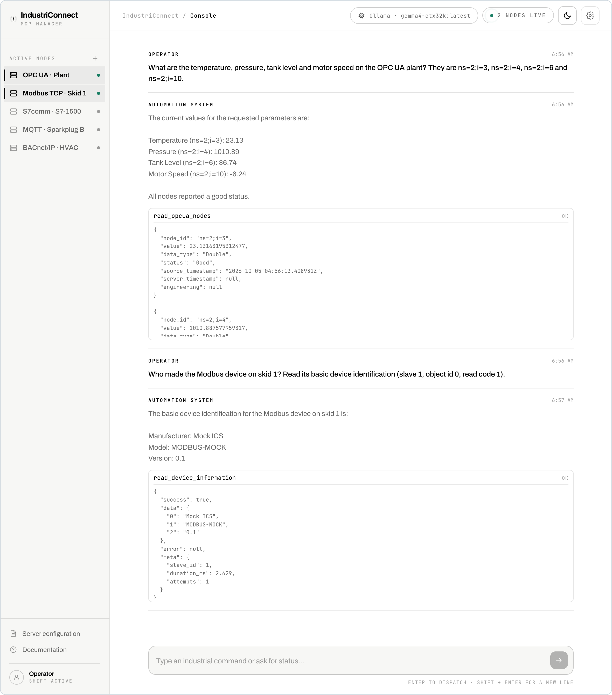
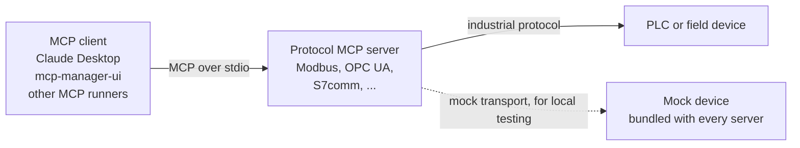

# IndustriConnect MCP Suite

[](LICENSE)
[](https://modelcontextprotocol.io)
[](#repository-layout)

A collection of Model Context Protocol (MCP) servers and tools for industrial automation protocols. The suite lets AI assistants and other MCP‑compatible clients talk to real (or simulated) PLCs and control systems using familiar protocols like Modbus, MQTT/Sparkplug B, OPC UA, BACnet, DNP3, EtherCAT, EtherNet/IP, PROFIBUS, PROFINET, and Siemens S7 (S7comm).

This repository brings the suite together. Each protocol server is developed in its own repository under [IndustriAgents](https://github.com/IndustriAgents) and pinned here as a git submodule, alongside `mcp-manager-ui` and the whitepaper.

<p align="center">
  <picture>
    <source media="(prefers-color-scheme: dark)" srcset="docs/images/mcp-manager-ui-dark.png">
    
  </picture>
  <br>
  <sub><a href="#mcp-manager-ui"><code>mcp-manager-ui</code></a> talking to the OPC UA and Modbus servers, which are reading from their bundled mocks.</sub>
</p>

All protocol stacks follow the same pattern:

- A Python MCP server that exposes a consistent set of tools over stdio
- A mock device/server that simulates a realistic industrial process for safe local testing
- A shared response envelope: `{ success, data, error, meta }`

The `mcp-manager-ui` project adds a web UI for working with these servers and other MCP backends from a single place.

---

## Repository Layout

Top‑level structure:

```text
IndustriConnect/
├── BACnet-Project/      # submodule -> IndustriAgents/BACnet-MCP
├── DNP3-Project/        # submodule -> IndustriAgents/DNP3-MCP
├── EtherCAT-Project/    # submodule -> IndustriAgents/EtherCAT-MCP
├── EtherNetIP-Project/  # submodule -> IndustriAgents/EtherNetIP-MCP
├── MODBUS-Project/      # submodule -> IndustriAgents/MODBUS-MCP
├── MQTT-Project/        # submodule -> IndustriAgents/MQTT-MCP
├── OPCUA-Project/       # submodule -> IndustriAgents/OPCUA-MCP
├── PROFIBUS-Project/    # submodule -> IndustriAgents/PROFIBUS-MCP
├── PROFINET-Project/    # submodule -> IndustriAgents/PROFINET-MCP
├── S7comm-Project/      # submodule -> IndustriAgents/S7comm-MCP
├── mcp-manager-ui/      # Web UI for managing MCP servers and LLMs
├── whitepaper/          # Architecture and design background
└── docs/images/         # Screenshots used in this README
```

Every `*-Project/` folder is a git submodule, so it stays empty until you
initialise it. The cloning note under
[Quick Start](#quick-start-example-modbus) explains how. Each submodule tracks
the `main` branch of its repository. Every hour the
[Sync protocol submodules](.github/workflows/sync-submodules.yml) workflow
opens or updates one pull request that moves the pins forward. A protocol
repository that sends a `protocol-mcp-updated` dispatch when its `main` moves
gets picked up straight away.

Updates reach the suite after that pull request is merged. To refresh an
existing local checkout, run these commands from the suite's `main` branch:

```bash
git pull --ff-only
git submodule update --init --recursive
```

Separate development checkouts, such as those under `Connect-MCPs/`, do not
share working files with these submodules. Commit and merge protocol changes
into their own repository's `main` branch before the sync can pick them up.

Each protocol repository has:

- `*-python/` – Python MCP server (`uv` + `mcp[cli]` or FastMCP)
- `*-mock-*` – Mock device or server that simulates a plant/process
- `README.md` – Protocol‑specific docs and quickstart

OPC UA is laid out differently. `OPCUA-Project/` keeps everything under
`packages/`: `server-python`, `server-node`, `mock-server` and a few
specialised mocks. Its README covers all of them.

> Note: The suite is Python‑first, with a consistent layout and tooling across all protocols. Earlier TypeScript/Node implementations have been removed, except for OPC UA's `packages/server-node`, which serves the same tool contract as its Python counterpart.

---

## What Is MCP and Why Here?

The Model Context Protocol (MCP) is a simple, transport‑agnostic way to expose tools and data sources to AI assistants over stdio. In this suite, MCP servers act as protocol‑aware “gateways” between an assistant and industrial systems:



This separation keeps:

- **Industrial protocol logic** in focused Python projects
- **Conversation and UX** in clients like Claude or `mcp-manager-ui`

You can safely develop and test flows against mocks before connecting to real PLCs or field devices.

---

## Projects Overview

Each protocol folder is a git submodule tracking the repository the server is developed in:

| Protocol | Folder → repository | MCP server | Mock |
|---|---|---|---|
| Modbus | `MODBUS-Project/` → [MODBUS-MCP](https://github.com/IndustriAgents/MODBUS-MCP) | **modbus-python**: Modbus TCP/UDP/RTU client | **modbus-mock-server**: Modbus TCP device with a realistic register map |
| MQTT / Sparkplug B | `MQTT-Project/` → [MQTT-MCP](https://github.com/IndustriAgents/MQTT-MCP) | **mqtt-python**: publish, subscribe, Sparkplug lifecycle | **mqtt-mock-server**: Sparkplug edge nodes; requires a separate MQTT broker such as Mosquitto |
| OPC UA | `OPCUA-Project/` → [OPCUA-MCP](https://github.com/IndustriAgents/OPCUA-MCP) | **packages/server-python**: read/write nodes, browse, methods, bulk operations<br>**packages/server-node**: the same tool contract on Node, published to npm | **packages/mock-server**: an industrial plant with sensors, actuators and methods |
| BACnet/IP | `BACnet-Project/` → [BACnet-MCP](https://github.com/IndustriAgents/BACnet-MCP) | **bacnet-python** | **bacnet-mock-device**: discovery and property access |
| DNP3 | `DNP3-Project/` → [DNP3-MCP](https://github.com/IndustriAgents/DNP3-MCP) | **dnp3-python**: DNP3 master | **dnp3-mock-outstation** |
| EtherCAT | `EtherCAT-Project/` → [EtherCAT-MCP](https://github.com/IndustriAgents/EtherCAT-MCP) | **ethercat-python**: PySOEM-based | **ethercat-mock-slave**: local smoke tests |
| EtherNet/IP | `EtherNetIP-Project/` → [EtherNetIP-MCP](https://github.com/IndustriAgents/EtherNetIP-MCP) | **ethernetip-python**: Rockwell/AB controllers | **ethernetip-mock-server**: JSON bridge with representative tags and UDTs; enable `ENIP_JSON_BRIDGE` for this mock |
| PROFIBUS | `PROFIBUS-Project/` → [PROFIBUS-MCP](https://github.com/IndustriAgents/PROFIBUS-MCP) | **profibus-python**: mock backend and GSD parsing; real DP master is not implemented | **profibus-mock-slave**: TCP mock; use `PROFIBUS_BACKEND=mock` |
| PROFINET | `PROFINET-Project/` → [PROFINET-MCP](https://github.com/IndustriAgents/PROFINET-MCP) | **profinet-python**: network DCP discovery and GSDML parsing; I/O and configuration use the mock backend | **profinet-mock-server**: JSON mock IO device; use `PROFINET_BACKEND=mock` |
| Siemens S7 | `S7comm-Project/` → [S7comm-MCP](https://github.com/IndustriAgents/S7comm-MCP) | **s7comm-python**: uses `python-snap7` | **s7comm-mock-server**: Siemens PLC for DB, I/O and SZL tests |

[`mcp-manager-ui/`](#mcp-manager-ui) lives in this repository. It is a React +
TypeScript console that connects to several MCP servers at once, chats with an
LLM that can call their tools, and shows each tool call and its response.

For details and protocol‑specific examples, open the `README.md` in each project directory, or on the project's repository.

Modbus, MQTT, BACnet, DNP3, EtherCAT, EtherNet/IP, PROFIBUS, PROFINET and S7
writes are disabled by default. Enable their documented switches through the
process environment or an explicit `--env-file`; automatic project `.env`
loading does not enable write gates. Keep the defaults for read-only use.

---

## Common Design Patterns

Across all protocol servers:

- **Transport**: stdio MCP servers, usually run via `uv run <entrypoint>`
- **Config**: environment variables and optional `.env` files (e.g., host, port, timeouts)
- **Envelope**: tools return a consistent shape:

  ```json
  {
    "success": true,
    "data": { "...": "protocol-specific payload" },
    "error": null,
    "meta": { "latency_ms": 12, "raw": {} }
  }
  ```

- **Mocks first**: every stack ships with a mock device/server so you can:
  - Develop prompts and workflows safely
  - Debug tools without needing access to production hardware
  - Reproduce issues deterministically

---

## Quick Start (Example: Modbus)

> **Cloning:** every `*-Project/` folder is a git submodule. Clone with
> `git clone --recurse-submodules https://github.com/IndustriAgents/IndustriConnect.git`,
> or run `git submodule update --init --recursive` in an existing clone.
> To move every protocol server to the latest `main` of its repository, run
> `git submodule update --remote`. To move just one, name it, for example
> `git submodule update --remote MODBUS-Project`. Running `git submodule update`
> without `--remote` returns them to the commits this repository pins.

1. **Start the Modbus mock device**

   ```bash
   cd MODBUS-Project/modbus-mock-server
   uv sync
   uv run modbus-mock-server  # listens on 0.0.0.0:1502
   ```

2. **Run the Modbus MCP server**

   ```bash
   cd ../modbus-python
   export MODBUS_TYPE=tcp
   export MODBUS_HOST=127.0.0.1
   export MODBUS_PORT=1502
   export MODBUS_DEFAULT_SLAVE_ID=1
   uv sync
   uv run modbus-mcp
   ```

3. **Wire it into Claude Desktop (or another MCP client)**

   Example `claude_desktop_config.json` snippet:

   ```json
   {
     "mcpServers": {
       "Modbus MCP (Python)": {
         "command": "uv",
         "args": ["--directory", "/absolute/path/to/IndustriConnect/MODBUS-Project/modbus-python", "run", "modbus-mcp"],
         "env": {
           "MODBUS_TYPE": "tcp",
           "MODBUS_HOST": "127.0.0.1",
           "MODBUS_PORT": "1502",
           "MODBUS_DEFAULT_SLAVE_ID": "1"
         }
       }
     }
   }
   ```

4. **Ask the assistant to use the tools**

   Once connected, you can say things like:

   - “Read the first 10 holding registers from the mock Modbus device.”
   - “Increase the pump speed setpoint to 60%.”

Replace the paths and environment variables for other protocols; each project’s README contains protocol‑specific examples and configuration.

---

## mcp-manager-ui

The `mcp-manager-ui` project provides a browser UI for:

- Managing MCP backends (including these protocol servers)
- Testing tools interactively
- Running conversations against one or more MCP servers

```bash
cd mcp-manager-ui
npm install
(cd mcp-backend && npm install)
PORT=3003 npm run dev   # UI on http://localhost:3000, backend on port 3003
```

Add servers under **Server configuration** in the same `mcpServers` JSON
format Claude Desktop and Cursor use (`mcp-config-example.json` is a starting
point), then click a node in the sidebar to connect it. The backend launches
each server over stdio, so you only start the mocks or devices they point at.
Pick the model with the model button in the top bar: OpenAI, Gemini or
Anthropic with your API key, or a local Ollama model. The model calls the
connected servers' tools and answers in plain language, with each tool call
and its result listed under the answer. The screenshot at the top of this page
is the console with the OPC UA and Modbus servers connected to their mocks and
a local Ollama model answering.

See [`mcp-manager-ui/README.md`](mcp-manager-ui/README.md) for LLM provider
setup and the rest of the options.

---

## Whitepaper and Architecture

For a deeper dive into the motivation, architecture, and design decisions behind this suite (including security, safety, and roadmap), see:

- `whitepaper/` – high‑level whitepaper for the IndustriConnect MCP suite

---

## Contributing

Contributions are welcome — new tools or wider coverage in an existing
protocol, better mocks and test scenarios, documentation and examples, or a
protocol the suite does not cover yet.

Each protocol server is developed in its own repository, so issues and pull
requests for a server or its mock go there. This repository takes changes to
`mcp-manager-ui`, the whitepaper, the suite-wide docs and the submodule pins.

[**CONTRIBUTING.md**](CONTRIBUTING.md) lists the protocol repositories and
covers the layout every protocol project follows, how to run a server against
its mock, and the three invariants that keep all ten consistent. Please also
read the [Code of Conduct](CODE_OF_CONDUCT.md).

## Security

These servers talk to industrial equipment, and most of the protocols they
speak have no authentication of their own. [**SECURITY.md**](SECURITY.md)
explains how to run them safely and how to report a vulnerability privately —
please do not open a public issue for one.

## 📌 Citation
If you use this work, please cite:

```bibtex
@misc{xavier2026industriconnectmcpadaptersmockfirst,
  title={IndustriConnect: MCP Adapters and Mock-First Evaluation for AI-Assisted Industrial Operations},
  author={Melwin Xavier and Melveena Jolly and Vaisakh M A and Midhun Xavier},
  year={2026},
  eprint={2603.24703},
  archivePrefix={arXiv},
  primaryClass={cs.SE},
  url={https://arxiv.org/abs/2603.24703}
}
```

---

## License

Released under the [MIT License](LICENSE).

## Verify protocol implementations

The [protocol architecture and build guide](docs/protocol-architecture.md)
explains the shared execution boundaries, supported native backends, and
verification of installed artifacts. After initializing the submodules, run:

```sh
python3 scripts/mcp_workspace.py verify
```

This checks and builds the nine Python protocol servers, validates their npm
launchers, and tests the installed artifacts. OPC UA retains its own runtime
and conformance workflow. Reports and logs are written under `.build/`.
